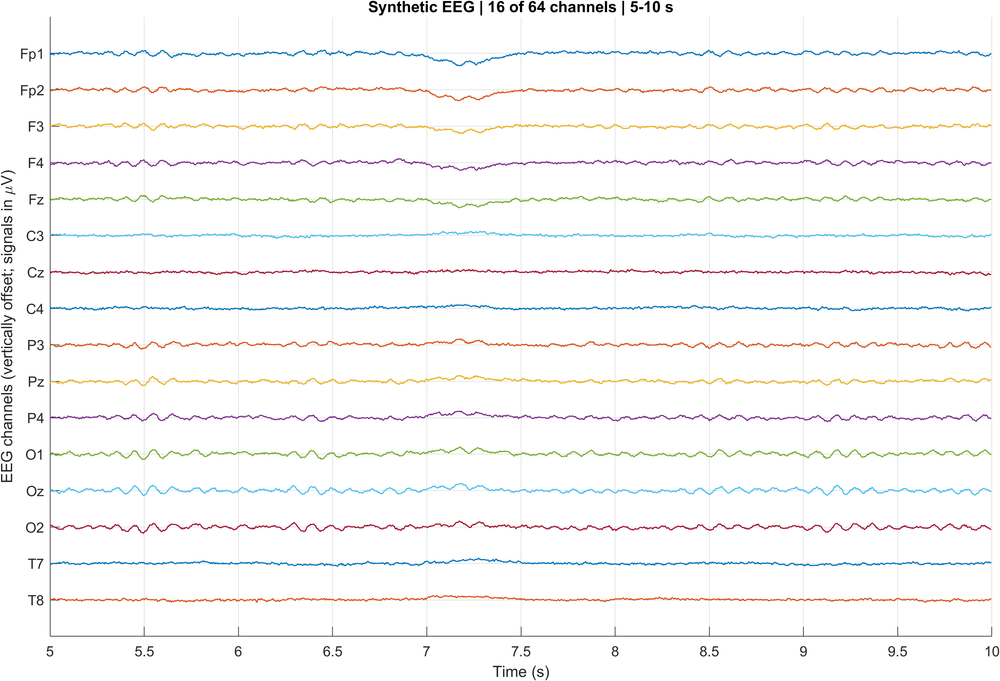
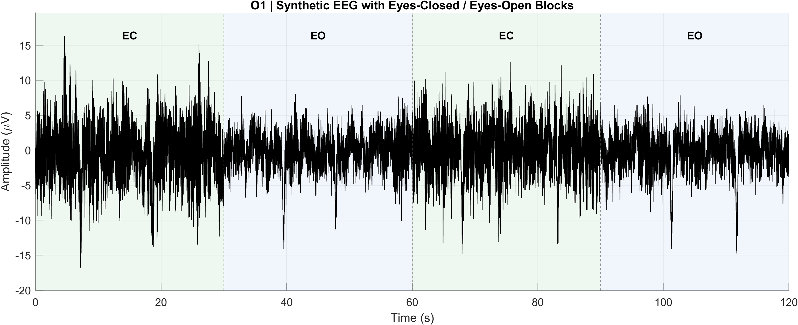
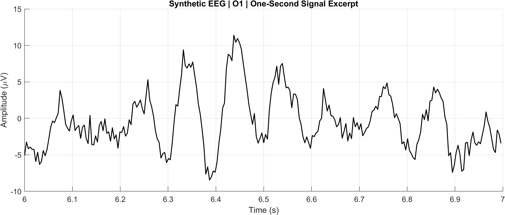
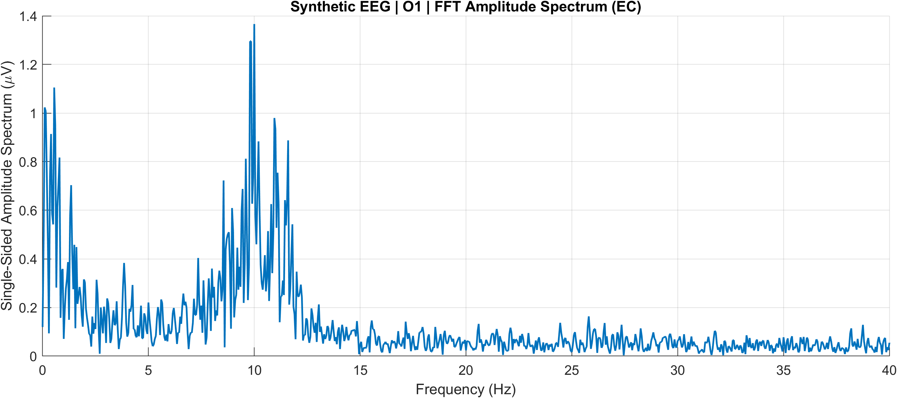
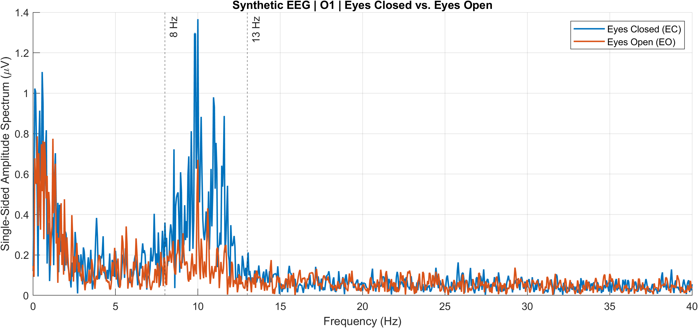

# EEG Signal Processing in MATLAB

**A beginner-friendly MATLAB project for generating and visualizing a synthetic multichannel EEG recording**

This repository contains a small educational EEG project built in **MATLAB**. It introduces the basic structure of an EEG dataset, demonstrates how to generate a **synthetic 64-channel recording**, and shows how to visualize EEG signals in the **time domain** and make a first transition toward the **frequency domain**.

> **Important:** This dataset is completely **synthetic**. It is **not** a recording from a human participant and should be used only for education, coding practice, and method demonstrations.

---

## Project Goals

This project is designed to help beginners:

- understand how EEG data can be stored in MATLAB,
- work with **channel labels**, **electrode coordinates**, and **sampling frequency**,
- generate a controlled synthetic EEG recording,
- visualize **multichannel EEG signals**,
- inspect a full recording with **eyes-closed (EC)** and **eyes-open (EO)** blocks,
- explore a first **FFT-based frequency visualization** before moving to PSD and more advanced analyses.

---

## Repository Structure

```text
ProjectN1/
├── README.md
├── data/
│   ├── electrodes.tsv
│   └── synthetic_eeg_64ch.mat
├── figures/
│   ├── 01_raw_traces.png
│   ├── 01_raw_traces.svg
│   ├── 01_raw_traces.fig
│   ├── 01_O1_full_recording.png
│   ├── 01_O1_full_recording.svg
│   ├── 01_O1_full_recording.fig
│   ├── 01_O1_zoom.png
│   ├── 01_O1_zoom.svg
│   ├── 01_O1_zoom.fig
│   ├── 01_O1_fft_spectrum.png
│   ├── 01_O1_fft_spectrum.svg
│   ├── 01_O1_fft_spectrum.fig
│   ├── 01_EC_EO_fft_comparison.png
│   ├── 01_EC_EO_fft_comparison.svg
│   └── 01_EC_EO_fft_comparison.fig
└── matlab/
    ├── 00_generate_synthetic_eeg.m
    └── 01_visualize_raw_eeg.m
```

---

## Requirements

- **MATLAB R2024** (or a compatible recent version)
- No EEGLAB required for the current tutorials
- No third-party toolboxes required for the core scripts

---

## Getting Started

### 1. Open the project in MATLAB
Set your **Current Folder** to the `matlab` directory.

```matlab
cd('path_to_ProjectN1/matlab')
```

### 2. Generate the synthetic EEG dataset
Run:

```matlab
run('00_generate_synthetic_eeg.m')
```

This script creates a synthetic 64-channel EEG dataset and saves it to:

```text
data/synthetic_eeg_64ch.mat
```

### 3. Visualize the EEG recording
Run:

```matlab
run('01_visualize_raw_eeg.m')
```

This script loads the synthetic dataset, creates several figures, and saves them to:

```text
figures/
```

---

## Tutorial Overview

### Tutorial 00 — Generate a Synthetic EEG Dataset
**File:** `matlab/00_generate_synthetic_eeg.m`

This script demonstrates how to build a simple synthetic EEG recording with:

- **64 channels**
- **256 Hz** sampling frequency
- **120 seconds** of data
- standard electrode labels and coordinates
- delta, theta, alpha, and beta-like components
- alternating **eyes-closed (EC)** and **eyes-open (EO)** blocks
- simulated **eye-blink artifacts**
- simulated **muscle-like artifacts**
- an intentionally noisy channel segment
- a synthetic average reference

### Tutorial 01 — Visualize a Multichannel EEG Recording
**File:** `matlab/01_visualize_raw_eeg.m`

This script demonstrates how to:

- load the EEG dataset,
- inspect the data matrix,
- create a time vector,
- select channels by their names,
- visualize a 5-second multichannel excerpt,
- inspect a full 120-second recording from a posterior channel,
- zoom into a short EEG segment,
- visualize the FFT amplitude spectrum,
- compare EC and EO spectra from the same channel,
- save figures as **PNG**, **SVG**, and **MATLAB FIG** files.

---

## Synthetic Recording Design

The current synthetic dataset includes alternating resting-state blocks:

| Time Interval (s) | Condition |
|---|---|
| 0–30 | Eyes Closed (EC) |
| 30–60 | Eyes Open (EO) |
| 60–90 | Eyes Closed (EC) |
| 90–120 | Eyes Open (EO) |

Posterior alpha activity was intentionally simulated to be stronger during **eyes-closed** periods.

---

## Example Figures

### 1. Multichannel EEG visualization (5-second excerpt)
A subset of 16 channels is displayed using vertical offsets for readability.



---

### 2. Full O1 recording with EC/EO blocks
The O1 electrode is shown across the full 120-second synthetic recording, with background shading for eyes-closed and eyes-open intervals.



---

### 3. Zoomed one-second EEG segment
A short excerpt helps visualize the waveform on a smaller time scale.



---

### 4. FFT amplitude spectrum of O1
This figure provides a first look at the signal in the frequency domain.



---

### 5. EC vs EO frequency-domain comparison
This figure compares the FFT amplitude spectra of a posterior channel during eyes-closed and eyes-open intervals.



---

## Output Files

The visualization script saves figures in three formats. 

---

## Notes and Limitations

- This project uses **synthetic** EEG data only.
- The simulated signals are designed for **teaching and demonstration**, not physiological validation.
- The frequency components, spatial weights, and artifact models are intentionally simplified.
- The FFT plots in Tutorial 01 are introductory visualizations. A more formal treatment of **Power Spectral Density (PSD)** and **Welch's method** should be introduced in a later tutorial.
- Topographic mapping (**topomap**) is not the main focus of the current tutorial and can be added in a future tutorial.


---

## Citation / Use

If you reuse or adapt this educational material, please clearly state that the dataset is **synthetic** and that the project was developed for learning and demonstration purposes.

---

## Author

**Duygu Duman**

Biomedical Engineering / EEG Signal Processing / Brain Connectivity / MATLAB-based analysis

